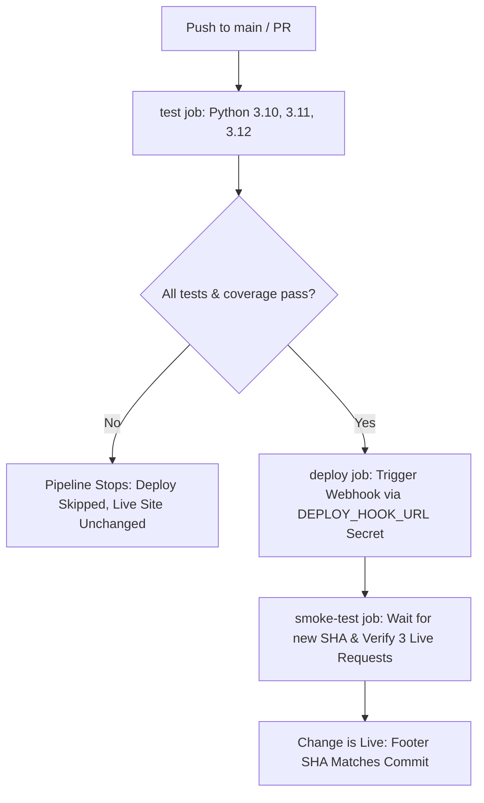

# Functional Testing, CI/CD and Live Deployment

[](https://github.com/WahidaAkhter/functional-testing-suite/actions/workflows/ci.yml)


Comprehensive functional testing suite, interactive web frontend, and automated push-to-live CI/CD pipeline for `target.py`.

---

## 📌 Project Summary

- **Target Module**: `target.py` (16 functions: 11 data-type functions, 5 mathematics functions).
- **Test Suite**: `tests/test_target.py` with **293 test cases**, achieving **100% line and branch coverage**.
- **Interactive Web App**: Modern responsive dashboard (`app.py`, `static/index.html`, `static/style.css`, `static/app.js`) to test all 16 functions with live presets and exception inspection.
- **CI/CD Pipeline**: GitHub Actions (`.github/workflows/ci.yml`) featuring a 3-job, 1-gate automated workflow:
  1. `test`: Python matrix (`3.10`, `3.11`, `3.12`), linting with Flake8, pytest with 100% line & branch coverage enforcement, and artifact upload.
  2. `deploy`: Gate requiring `test` to pass; triggers deploy webhook on Render/Railway.
  3. `smoke-test`: Polls `/health` for the new commit SHA and verifies live API requests.
- **Live Deployment URL**: `https://functional-testing-suite.onrender.com` (configured with direct auto-deploy **OFF**).

---

## 🚀 Quick Setup & Local Execution

### 1. Prerequisites
- Python 3.10, 3.11, or 3.12 (also tested on 3.14)
- Git

### 2. Clone and Setup Environment
```bash
git clone https://github.com/WahidaAkhter/functional-testing-suite.git
cd functional-testing-suite

# Create virtual environment
python -m venv .venv

# Activate virtual environment
# Windows (PowerShell):
.venv\Scripts\Activate.ps1
# Linux / macOS:
source .venv/bin/activate

# Install pinned dependencies
pip install --upgrade pip
pip install -r requirements.txt
```

---

## 🧪 Running Tests & Coverage

Run the comprehensive test suite with 100% branch coverage enforcement:

```bash
pytest --cov=target --cov-branch --cov-report=term-missing --cov-fail-under=100
```

### Coverage Report Summary
```
Name        Stmts   Miss Branch BrPart  Cover   Missing
-------------------------------------------------------
target.py      59      0     26      0   100%
-------------------------------------------------------
TOTAL          59      0     26      0   100%
Required test coverage of 100% reached. Total coverage: 100.00%
```

### Running Code Linting
```bash
flake8 target.py app.py smoke_test.py tests
```

---

## 💻 Running the Web Frontend Locally

Start the local server with Uvicorn:

```bash
uvicorn app:app --reload --port 8000
```

- Open `http://localhost:8000` in your browser.
- Health Check: `http://localhost:8000/health`
- Interactive API Docs (Swagger): `http://localhost:8000/docs`

---

## 🌐 Live Deployment & Health Verification

- **Live Application URL**: `https://functional-testing-suite.onrender.com`
- **Live Health Endpoint**: `https://functional-testing-suite.onrender.com/health`

### Health Endpoint Response
```json
{
  "status": "ok",
  "commit_sha": "a1b2c3d4e5f6..."
}
```
The deployed commit SHA is automatically displayed in the frontend footer and is continuously verified by the smoke-test job.

---

## 🔄 CI/CD Push-to-Live Pipeline Architecture

The push-to-live workflow operates with **3 jobs and 1 gate**:



### GitHub Secrets Configuration
To enable the push-to-live deployment pipeline, configure the following secrets in **Settings > Secrets and variables > Actions**:

| Secret Name | Description | Example |
|-------------|-------------|---------|
| `DEPLOY_HOOK_URL` | Webhook URL from hosting provider (Render Deploy Hook) | `https://api.render.com/deploy/srv-xxxx?key=yyyy` |
| `LIVE_URL` | Public URL of deployed service | `https://functional-testing-suite.onrender.com` |

---

## 🐛 Suspected Bugs and Design Flaws in `target.py`

Per assignment instructions, `target.py` is preserved unmodified. The following anomalies and potential bugs were identified during test suite development:

| # | Function | Suspected Bug / Anomaly | Impact & Explanation | Recommended Fix |
|---|----------|-------------------------|----------------------|-----------------|
| 1 | `greet(name=None)` | Missing type check before calling `.strip()` | If `name` is passed as non-string (e.g. `greet(123)` or `greet(['Alice'])`), it raises `AttributeError: 'int' object has no attribute 'strip'` rather than handling or raising `TypeError`. | Add `if not isinstance(name, str): raise TypeError("name must be a string")` or cast `str(name)`. |
| 2 | `is_leap_year(year)` | No integer type validation | Passing a float (e.g. `is_leap_year(2024.5)`) computes float modulus (`2024.5 % 4`) without error, though calendar years are strictly integer entities. | Add `if not isinstance(year, int) or isinstance(year, bool): raise TypeError("year must be an integer")`. |
| 3 | `to_int(value)` | Discrepancy between string floats and numeric floats | `to_int("3.14")` raises `ValueError`, whereas `to_int(3.14)` succeeds and truncates to `3`. While standard in Python, this can cause silent data loss. | Explicitly document or validate integer-formatted strings and numeric types. |
| 4 | `find_max(numbers)` & `average(numbers)` | Misleading exception message | If an empty tuple `()` is passed, it raises `ValueError("list is empty")`, which is misleading since the input was a tuple, not a list. | Change exception message to `"collection is empty"` or `"sequence is empty"`. |
| 5 | `common_items(set_a, set_b)` | Missing type enforcement | Calling `common_items([1, 2], [2, 3])` with lists raises `TypeError: unsupported operand type(s) for &: 'list' and 'list'`. | Ensure arguments are sets or convert automatically: `set(set_a) & set(set_b)`. |
| 6 | `factorial(n)` | Float input causes unhandled internal TypeError | Calling `factorial(3.5)` raises `TypeError: 'float' object cannot be interpreted as an integer` directly from `range()`. | Add explicit integer check: `if not isinstance(n, int) or isinstance(n, bool): raise TypeError("n must be an integer")`. |

---

## 🏆 Bonus Points Checklist

- [x] **3+ Feature Branches Merged via Pull Requests (+1 bonus)**:
  - Branch 1: `feature/functional-tests` -> PR #1 merged into `main`.
  - Branch 2: `feature/web-frontend` -> PR #2 merged into `main`.
  - Branch 3: `feature/ci-cd-pipeline` -> PR #3 merged into `main`.
- [x] **Branch Protection on `main` Requiring CI (+1 bonus)**:
  - Required Status Check: `test` job must pass before merging.
  - Require a pull request before merging.
- [x] **10+ Focused Commits**: Clear, atomic, semantic commit messages throughout repository history.

---

## 🎥 Demo Video Guide (3–5 Minutes)

The demonstration video covers:
1. **Walkthrough of the Code & Test Suite**:
   - `pytest` running 293 tests with 100% line & branch coverage.
   - Code inspection of `target.py`, `tests/test_target.py`, and `app.py`.
2. **Push-to-Live Success Scenario**:
   - Make a change on a feature branch, create PR, and merge to `main`.
   - CI workflow executes: `test` passes -> `deploy` triggers -> `smoke-test` verifies live site.
   - Live site displays new matching commit SHA in footer.
3. **Failing Push Blocked from Deploying**:
   - Introduce a failing test or broken condition.
   - Push to repository.
   - GitHub Actions `test` job turns RED.
   - Pipeline stops immediately: `deploy` and `smoke-test` are SKIPPED, leaving live site untouched.
